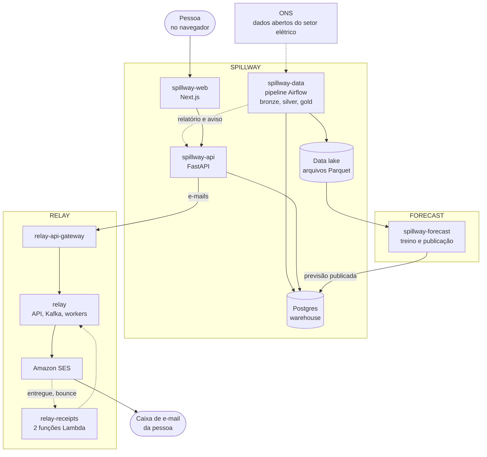

# 1. Visão geral

## 1.1 O que você construiu, em uma página

Você tem **três produtos que se encaixam**, cada um com um papel claro:

| Produto | Para que serve | Repositórios |
|---|---|---|
| **Spillway** | Mostrar quanta energia eólica e solar o Brasil deixa de gerar (o *curtailment*), mês a mês, estado a estado, usina a usina. É o site, com área de membros, relatórios, análises e previsão. | `spillway-data`, `spillway-api`, `spillway-web`, `spillway-infra` |
| **Relay** | Uma plataforma genérica para **enviar mensagens** (e-mail, SMS, WhatsApp, push) com garantias: nada se perde, tenta de novo, troca de fornecedor se um cair. O Spillway usa o Relay para mandar e-mails. Outros produtos futuros poderão usar também. | `relay`, `relay-api-gateway`, `relay-receipts`, `relay-terraform` |
| **Forecast** | Um modelo de aprendizado de máquina que estima **o risco de corte de energia hora a hora**, e a rotina que o treina, o publica e o mantém atualizado. | `spillway-forecast` |

> **Em resumo:** o Spillway é o produto que as pessoas veem. O Relay é a "central de correios" que o Spillway usa para falar com elas por e-mail. O Forecast é o "cérebro estatístico" que alimenta a página de previsão.

## 1.2 O mapa do ecossistema

O diagrama mostra quem fala com quem. As setas pontilhadas são caminhos que acontecem em segundo plano (agendados ou assíncronos).

## 1.3 Como ler esta documentação

- **Capítulos 2 a 5** explicam cada parte do **Spillway** (dados, API, site, infraestrutura).
- **Capítulos 6 e 7** explicam o **Relay** em profundidade, porque é a peça com mais decisões de engenharia.
- **Capítulo 8** explica o **Forecast**: dados, modelo, por que esse modelo, como é validado e como se mantém atualizado.
- **Capítulo 9** junta tudo em **fluxos de ponta a ponta** (diagramas de sequência).
- **Capítulo 10** é o **manual de operação**: como subir tudo, portas, variáveis, problemas comuns.
- **Capítulo 11** reúne as **decisões de arquitetura** em linguagem simples.
- **Capítulo 12** é o **estado atual**: o que está pronto, o que falta e os riscos.
- O **glossário** (capítulo 13) explica os termos técnicos e do setor elétrico.

Em cada capítulo, as caixas coloridas têm um papel fixo:

> **Por quê?** explica o motivo de uma decisão (e o que foi descartado).

> **Atenção:** avisa de um limite, risco ou pendência.

> **Dica:** mostra um atalho ou um jeito de usar.

## 1.4 Os repositórios

Todos ficam na pasta `projects` e no GitHub do usuário `LeonardoMatos07`. As pastas locais de quatro deles ainda têm o nome antigo (`energia-*`) por causa de uma renomeação que ficou pendente.

| Pasta local | Repositório no GitHub | Linguagem e stack | Papel |
|---|---|---|---|
| `energia-data` | `spillway-data` | Python, Airflow, Polars | Pipeline de dados do ONS |
| `energia-api` | `spillway-api` | Python, FastAPI, SQLAlchemy | API, regras de negócio, e-mails, exportações |
| `energia-web` | `spillway-web` | TypeScript, Next.js, Recharts | O site |
| `energia-infra` | `spillway-infra` | Terraform | Infraestrutura na AWS |
| `relay` | `relay` | TypeScript, NestJS, Kafka, Postgres, Redis | Plataforma de mensagens |
| `relay-api-gateway` | `relay-api-gateway` | TypeScript, Node puro | Porta de entrada simples para o Relay |
| `relay-receipts` | `relay-receipts` | Python, AWS Lambda | Recibos de entrega dos provedores |
| `relay-terraform` | `relay-terraform` | Terraform | SES, filas e Lambdas na AWS |
| `spillway-forecast` | `spillway-forecast` | Python, scikit-learn, MLflow | Previsão de risco de corte |
| `spillway-docs` | (local) | Markdown, Mermaid | Esta documentação |

> **Atenção:** o contrato entre os quatro repositórios do Spillway está escrito em `spillway-api/docs/phase1-contract.md`. Quando algo compartilhado muda (uma rota, uma tabela, uma variável de ambiente), a mudança começa por esse documento.

## 1.5 As cinco ideias que explicam o desenho

1. **Dados confiáveis antes de bonitos.** O pipeline guarda o arquivo original, valida, separa linhas ruins e só então publica. O site nunca mostra um número que não passou nas verificações.
2. **A API é a dona do banco.** Quem produz dados (pipeline, forecast) só escreve nas tabelas que a API definiu. Isso evita que dois sistemas discordem sobre o formato.
3. **Nada é enviado de forma síncrona se puder falhar.** E-mails vão para o Relay, que guarda, tenta de novo e troca de fornecedor. O site nunca fica esperando o SES.
4. **Tudo que pode ser repetido é seguro de repetir (idempotência).** Rodar o pipeline duas vezes, reenviar uma requisição, publicar a mesma previsão: o resultado é o mesmo, sem duplicar nada.
5. **Cada serviço pode cair sozinho.** Se o forecast parar, o site mostra a última previsão com a idade dela. Se o Relay parar, a API não perde o e-mail. Se o SES recusar, o Relay tenta outro caminho.
