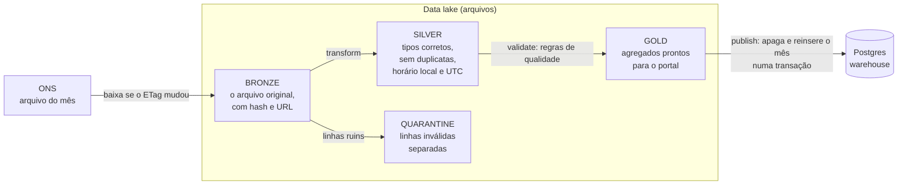
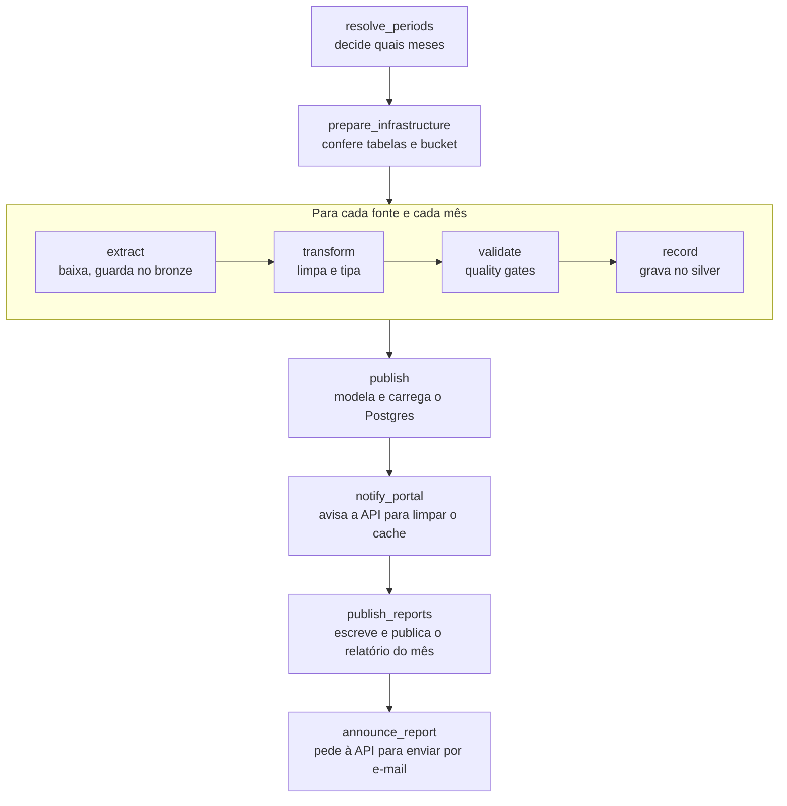
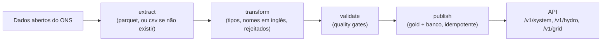

# 2. spillway-data: o pipeline de dados

## 2.1 O que ele faz

Todo mês o ONS (Operador Nacional do Sistema Elétrico) publica arquivos abertos com a energia eólica e solar que **deixou de ser gerada** por ordem do operador, em intervalos de 30 minutos, por usina e por conjunto de usinas. O `spillway-data` baixa esses arquivos, valida, transforma, calcula o impacto financeiro e carrega tudo no Postgres, pronto para a API consultar.

Ele roda no **Apache Airflow** (versão 3.3.2), que é o agendador: ele sabe quais passos existem, em que ordem, o que fazer quando um falha e mostra tudo numa interface (porta 8081 localmente).

## 2.2 As fontes de dados

| Fonte (ONS) | O que traz |
|---|---|
| Restrição de operação eólica e fotovoltaica, por **conjunto** (cluster) | O total oficial cortado, a cada 30 minutos. É o número que vale. |
| Restrição de operação eólica e fotovoltaica, por **usina** | A estimativa por usina e os motivos do corte |
| Geração por usina | Quanto cada usina realmente gerou |
| Capacidade instalada | Potência de cada usina (MW) e cadastro |
| Curva de carga | Consumo do sistema |
| Custo Marginal de Operação (CMO) | O preço de referência para valorar a energia perdida |

Uma segunda DAG (`ons_grid_pipeline`) cuida dos dados da rede elétrica; a principal para o site é `ons_curtailment_pipeline`.

## 2.3 A arquitetura em camadas (bronze, silver, gold)

Os dados passam por três estágios. É uma prática comum de engenharia de dados chamada **arquitetura medalhão**:

> **Por quê?** Guardar o **arquivo original (bronze)** permite reprocessar tudo se descobrirmos um erro de regra, sem depender de o ONS ainda ter o arquivo. A **silver** é a fonte confiável (também usada pelo Forecast). A **quarentena** evita que uma linha estranha derrube a carga inteira: ela é separada e contada, e se passar de 1% a carga é bloqueada.

## 2.4 O que o DAG faz, passo a passo

O DAG principal roda **no dia 3 de cada mês às 06:00** e reprocessa os **últimos 3 meses** (o ONS costuma revisar números já publicados).

Quatro dessas etapas merecem uma explicação:

1. **extract** só baixa se o `ETag` do arquivo mudou. Rodar o DAG de novo sem dado novo não baixa nada.
2. **validate** aplica as regras de qualidade. Qualquer verificação de nível "ERRO" **bloqueia a publicação**.
3. **publish** apaga e reinsere o mês inteiro **numa única transação**. Se algo falhar, o banco continua com o dado anterior.
4. **announce_report** só envia e-mail na **rodada mensal regular** e só para o mês mais recente. Um *backfill* (carga de anos antigos) **nunca** manda e-mail.

> **Atenção:** as duas últimas etapas (`publish_reports` e `announce_report`) foram acrescentadas depois, para fechar o ciclo "dado novo, relatório publicado, inscritos avisados". O DAG foi conferido (importa sem erros e lista as tarefas), mas só dispara de verdade na primeira rodada mensal real.

## 2.5 Como o número final é calculado (a regra de negócio)

Este é o coração do produto e está documentado como decisão de arquitetura (ADR 2).

1. **O número oficial vence.** O total cortado de cada conjunto é a "geração não realizada apurada" (GNRa): potência média em MW multiplicada por 0,5 hora.
2. **Divide por motivo**, proporcional aos minutos de restrição. Os motivos oficiais do ONS são:
   - **REL**: razão de confiabilidade elétrica (a rede precisava ser protegida);
   - **CNF**: indisponibilidade externa (uma linha ou subestação fora da usina estava desligada);
   - **ENE**: razão energética (havia mais energia do que consumo);
   - **outros**.
3. **Distribui para as usinas**, proporcional à perda estimada de cada uma nas meias horas em que houve restrição.
4. **Valora em reais**: cada meia hora cortada é multiplicada pelo CMO do subsistema, limitado pelo piso e teto anuais do PLD.

> **Por quê?** Estimar por usina sozinho dá números que não fecham com o total oficial. Fazer o oficial mandar e **distribuir** garante que a soma por usina, por estado e por subsistema é sempre igual ao total do ONS. Há uma rotina de **reconciliação** que soma os arquivos originais e compara com o que está no banco (tolerância de 1%).

> **Atenção:** o texto do ADR 2 troca a descrição de REL e CNF (diz que REL é indisponibilidade externa). O site e o ONS usam: REL = confiabilidade elétrica, CNF = indisponibilidade externa. Vale corrigir o texto do ADR.

## 2.6 O que chega ao banco

O pipeline escreve **apenas** em tabelas que a API já criou. Se faltarem, ele para e pede para rodar as migrações da API.

| Tabela | Conteúdo |
|---|---|
| `plant` | Cadastro das usinas e conjuntos (nome, estado, subsistema, empresa, ponto de conexão) |
| `plant_monthly_curtailment` | Por usina e mês: geração, corte total e por motivo, perda em R$, rankings |
| `state_monthly_curtailment`, `subsystem_monthly_curtailment` | Agregados por estado e subsistema (e SIN = Brasil), por fonte |
| `hourly_curtailment` | Perfil por hora do dia, tipo de dia (útil ou fim de semana) e mês |
| `load_run` | Histórico de cada execução do pipeline |

## 2.7 Backfill e reprocessamento

Um **backfill** carrega muitos meses de uma vez (foi o que carregou de 2021-10 a 2026-09). Pelo Airflow, dispara-se o DAG com os parâmetros `first_month` e `last_month`.

> **Dica:** o ONS publica a eólica desde 2021-10 e a solar desde 2024-04. Não existem dados anteriores a essas datas nessa fonte.

## 2.8 Onde roda

| Ambiente | Onde | Armazenamento |
|---|---|---|
| Local | Docker Compose (Airflow, Postgres do warehouse na porta 5433, SeaweedFS como lake) | SeaweedFS (porta 8333, compatível com S3) |
| Produção | Uma máquina EC2 sem SSH (acesso por SSM) na AWS | Bucket S3 versionado e criptografado |

## 2.9 As novas fontes do ONS (sistema, água e rede)

Além do curtailment, o `spillway-data` agora carrega mais quatro grupos de dados do ONS. Cada grupo é um **pipeline** (um DAG no Airflow, rodando no dia 3 de cada mês, reprocessando os últimos 3 meses) e escreve em tabelas novas do banco, sempre em transação única e sem duplicar.

| Pipeline (DAG) | Fontes | Tabelas no banco |
|---|---|---|
| `system` (`ons_system_pipeline`, 07:00) | balanço de energia, carga, geração por usina, capacidade, intercâmbio nacional e internacional, despacho térmico | `subsystem_hourly_balance`, `subsystem_monthly_generation`, `power_plant`, `plant_monthly_generation`, `interchange_hourly`, `interchange_monthly`, `thermal_dispatch_monthly` |
| `hydrology` (`ons_hydrology_pipeline`, 08:00) | cadastro de reservatórios, EAR e ENA por subsistema e por reservatório, vazões e cotas, energia vertida turbinável | `reservoir`, `subsystem_storage_daily`, `reservoir_daily`, `plant_monthly_spilled_energy` |
| `grid_assets` (`ons_grid_assets_pipeline`, 09:00) | linhas de transmissão, subestações, transformadores | `transmission_line`, `substation`, `transformer_capacity` (com histórico) |

> **Por quê um pipeline por assunto?** Cada assunto tem seu ritmo, seus arquivos e seus erros. Separar evita que um problema na hidrologia atrase o relatório de curtailment, que já tem e-mail mensal ligado a ele.

O que os dados reais ensinaram (e virou regra no código):

- **Intercâmbio:** o ONS lista cada link na direção do fluxo da hora, sempre com valor positivo. A camada silver fixa a direção de cada link (N→NE, N→SE, NE→SE, S→SE) e dá sinal ao fluxo: positivo é de origem para destino.
- **Balanço:** o arquivo traz um subsistema `SIN` (total); ele é recalculado a partir dos quatro subsistemas para não entrar em dobro. Leituras solares levemente negativas à noite (−0,16 MW) são ruído e são toleradas.
- **Reservatórios:** a energia armazenada de um reservatório é **negativa** abaixo do volume mínimo (2015: até −83%) e passa de 100% quando ele vaza (até 379%). Só valores absurdos (erro de unidade) bloqueiam a carga.
- **Códigos:** o ONS usa três códigos para o mesmo reservatório (planejamento, `res_id` e `cod_usina`); o cadastro faz a ponte e alguns reservatórios sem código ligam pelo nome.
- **Térmicas novas** podem não ter código de planejamento: a chave cai para o CEG.
- **Rede com histórico:** a cada mês o cadastro inteiro é lido e só se escreve uma linha nova quando algo mudou (`valid_from` e `valid_to`), para o mapa poder mostrar a expansão da rede.

> **Atenção:** o backfill da hidrologia começou em **2015** (já carregado localmente até 2026-09); o histórico anterior (EAR e ENA desde 2000, dados hidrológicos desde 1970) é uma execução à parte, bastando recuar `HYDRO_START`.
