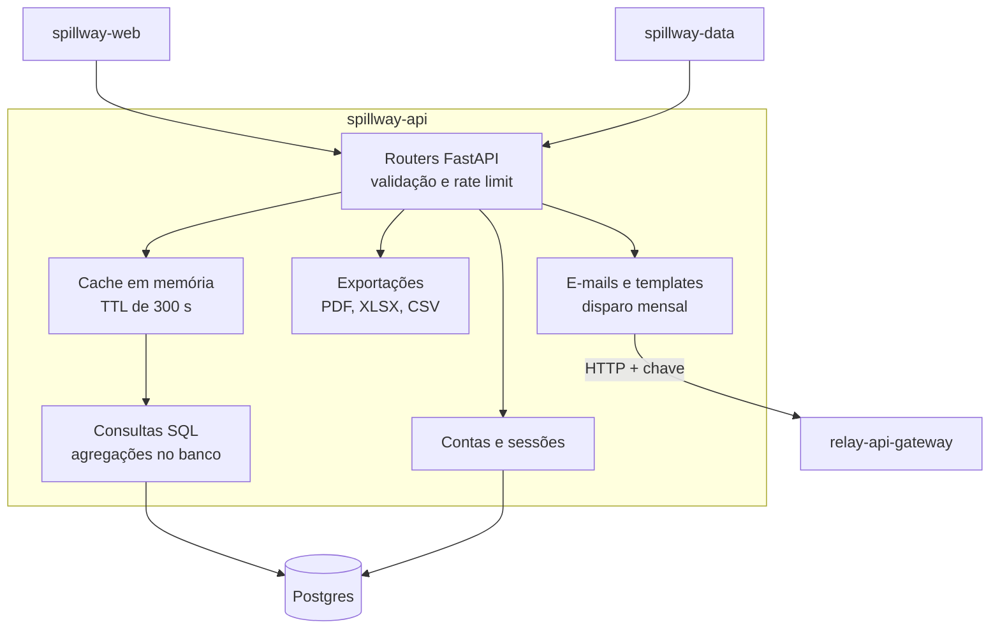
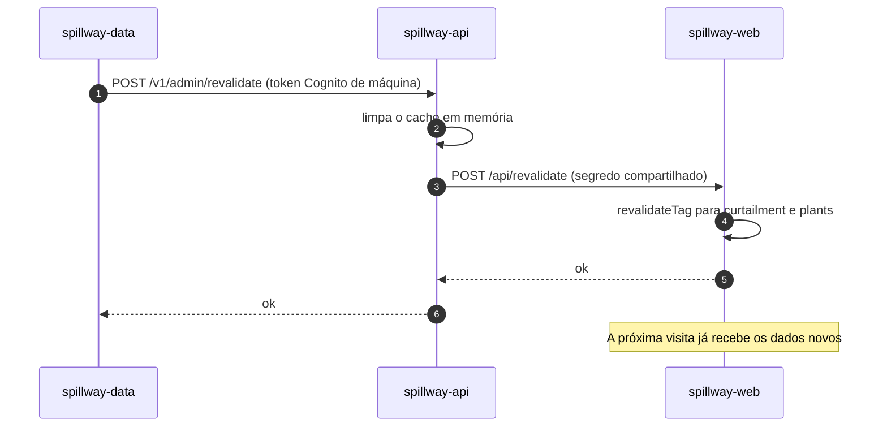

# 3. spillway-api: a API e as regras de negócio

## 3.1 Papel

A `spillway-api` é o **cérebro e o guardião do banco**. Ela:

- é a **única dona do esquema do Postgres** (migrações com Alembic, hoje até a `0007`);
- responde ao site com os dados de curtailment, usinas, rankings, relatórios e previsão;
- cuida de **contas de membros** (cadastro com código por e-mail, login, sessão);
- gera **PDF, Excel e CSV** das análises e o PDF dos relatórios;
- monta e **dispara e-mails** (código de verificação, relatório mensal, boas-vindas) pelo Relay;
- registra **eventos de uso** do site para a área administrativa.

Stack: Python 3.12, FastAPI, SQLAlchemy 2, psycopg, Alembic, Pydantic. Testes com pytest (cerca de 240), verificação de tipos com mypy estrito e lint com ruff.

## 3.2 Mapa das rotas

| Grupo | Rotas principais | Quem usa |
|---|---|---|
| Dados | `/v1/curtailment/{subsystems, states/{uf}, summary, hourly}`, `/v1/plants`, `/v1/rankings/{operators, connection-points}` | Site (páginas de dados) |
| Relatórios | `/v1/reports`, `/v1/reports/{slug}`, `/v1/reports/{slug}/pdf` | Site |
| Exportações | `/v1/exports/analysis.pdf`, `/v1/exports/analysis.xlsx`, `/v1/exports/analysis-csv.zip` | Site (botão Baixar) |
| Conta | `/v1/auth/{signup, verify-email, resend-verification, login, me, logout, forgot-password, reset-password}` e `/v1/auth/me/newsletter` | Site |
| Newsletter | `/v1/newsletter` (+ `/confirm`, `/unsubscribe`) | Site |
| Previsão | `/v1/forecast`, `/v1/forecast/scopes`, `/v1/forecast/model` | Site |
| Uso | `/v1/events` | Site (rastreio de visitas) |
| Administração | `/v1/admin/{reports, revalidate, dispatches, leads, usage/*, load-runs}` | Pipeline e administradores |

## 3.3 Camadas da aplicação



## 3.4 Contas, segurança e acesso

Há dois mundos de autenticação, por motivos diferentes:

| Quem | Como autentica | Detalhes |
|---|---|---|
| **Membros** (público cadastrado) | E-mail e senha, com **código de 6 dígitos por e-mail** para verificar o endereço | Senha com `scrypt`. A sessão é um token aleatório cujo **hash** é guardado (o token em si nunca fica no banco). Dura 14 dias. O código vale 30 minutos e tem limite de tentativas. |
| **Administradores e máquinas** (pipeline) | **Amazon Cognito** (JWT) | Administradores com MFA obrigatório. O pipeline usa credenciais de máquina (*client credentials*) com o escopo `admin`. |

Proteções que valem a pena conhecer:

- **Limite de requisições** por IP em cadastro, login, newsletter e downloads (por exemplo, 5 por minuto na newsletter, 20 por minuto nos downloads).
- **Cadastro com e-mail já existente** responde `409` "já existe uma conta", sem enviar e-mail (decisão sua: a clareza para o usuário vale mais que esconder se o e-mail existe).
- O site repassa o IP real do visitante à API usando um segredo compartilhado (`WEB_API_SECRET`), para o limite por IP funcionar atrás do proxy.

## 3.4.1 Quem pode ver o quê no site

Só a **página inicial, a metodologia, a privacidade, o cadastro e o login** são abertas. Painel, estados, usinas, relatórios, análises, comparação, previsão e conta exigem login.

> **Por quê?** O site passou a ser um produto para membros (gera relacionamento, base para o e-mail mensal). Os dados da API continuam técnicos e abertos; a regra de quem vê o quê é aplicada na camada do site (middleware mais verificação da sessão no layout).

## 3.5 Cache: como o site fica rápido sem ficar velho

Há **três camadas de cache**, cada uma com um motivo:

| Camada | Duração | Quem limpa |
|---|---|---|
| Cache em memória da API | 300 s | Rota administrativa `revalidate` |
| Cache de `fetch` do Next.js no site | 1 hora (30 minutos na previsão) | A mesma rota, por **tags** (`curtailment`, `plants`, `reports`) |
| Navegador (roteador do Next) | 30 s nas páginas dinâmicas | Expira sozinho |

Quando o pipeline termina uma carga, ele não espera as horas passarem: avisa a API, que limpa o cache dela e chama o site para invalidar as tags (decisão 4, no capítulo 11).



## 3.6 Exportações (PDF, Excel, CSV)

Na página de Análises, o botão **Baixar** tem duas opções:

- **PDF**: segue as três visões da tela (Compensação, Empresas e conexões, Perfil horário) com **todas** as linhas e um gráfico horário. Feito com `reportlab`.
- **Dados completos**: um **Excel** com uma aba por tabela (resumo, subsistemas por mês, estados por mês, empresas, pontos de conexão, perfil horário e **todas as usinas por mês**), ou um **ZIP de CSVs** com o mesmo conteúdo.

O PDF e os dados respeitam o **filtro da tela** (escopo, fonte, período): se você escolhe um mês, sai só aquele mês.

> **Por quê?** Um CSV só guarda uma tabela. Para entregar "todos os dados" em um único arquivo, o Excel é o formato natural. Para quem quer CSV, o ZIP mantém um arquivo por tabela.

## 3.7 Relatórios e gráficos dentro deles

Cada relatório mensal é um texto em **Markdown** gerado pelo pipeline. Para ter gráficos, o Markdown aceita um bloco especial:

~~~
```chart
{"type":"bar","title":"...","unit":"GWh","labels":[...],"series":[{"name":"...","values":[...]}]}
```
~~~

O mesmo texto é desenhado de **três maneiras**: no site com Recharts, no PDF com reportlab e no e-mail com barras feitas de células de tabela HTML (e-mail não executa JavaScript).

## 3.8 E-mails: modelos, variáveis e disparos

O Spillway é dono dos seus modelos de e-mail. O Relay é genérico e só preenche os valores.

| Modelo | Variáveis por pessoa | Usado quando |
|---|---|---|
| Código de verificação | nome, código | Cadastro e reenvio |
| Redefinir senha | nome, código | Esqueci a senha |
| Confirmação de newsletter | link de confirmação, link de cancelar | Inscrição pelo formulário |
| Boas-vindas à newsletter | nome, link de cancelar | Ao ativar a newsletter |
| Relatório mensal | nome, link de cancelar | Todo mês e no momento da ativação |
| Análises | nome | Envio opcional por administrador |

O **disparo mensal** (`POST /v1/admin/dispatches` ou o comando `python -m app.dispatch`) funciona assim:

- envia **uma vez por tipo e mês** (há uma tabela `email_dispatch` com restrição de unicidade);
- cada destinatário tem uma **chave de idempotência fixa** (tipo, mês, hash do e-mail): se o envio parar no meio, repete-se sem duplicar;
- o relatório vai **no corpo do e-mail**, abrindo com os quatro indicadores do mês (energia cortada, % de corte, perda estimada, usinas afetadas) e a variação contra o mês anterior.

## 3.9 Previsão publicada pelo banco

O site mostra a previsão lendo `forecast_run` e `forecast_hourly` no próprio Postgres. **A API nunca chama o serviço de ML**. Isso é explicado em detalhe no capítulo 8 e na decisão 7 (capítulo 11).

## 3.10 Migrações do banco

| Versão | O que criou |
|---|---|
| 0001 | Esquema inicial (usinas, curtailment mensal, relatórios, newsletter) |
| 0002 | Membros e sessões |
| 0003 | Perfil horário |
| 0004 | Eventos de uso |
| 0005 | Contagem de tentativas de código |
| 0006 | `email_dispatch` (envios mensais) |
| 0007 | Tabelas da previsão (`forecast_model`, `forecast_run`, `forecast_hourly`) |

> **Atenção:** em produção, uma migração nova só passa a existir depois do deploy da API. A permissão de escrita nas tabelas novas também precisa estar no `spillway-infra` (os scripts de permissão classificam toda tabela).

## 3.11 Endpoints do sistema elétrico, da água e da rede

Todos públicos, com cache e limpos pela revalidação. As tabelas e colunas estão no contrato (`docs/phase1-contract.md`).

| Rota | Para que serve |
|---|---|
| `GET /v1/system/balance` | balanço horário por subsistema (hidráulica, térmica, eólica, solar, carga, intercâmbio), até 31 dias |
| `GET /v1/system/generation` | geração mensal por fonte, com energia, média, pico e participação |
| `GET /v1/plants/{slug}/generation` | geração mensal de uma usina e fator de capacidade |
| `GET /v1/system/interchange` e `/hourly` | intercâmbio entre subsistemas e com outros países |
| `GET /v1/system/thermal-dispatch` | geração térmica por motivo do despacho |
| `GET /v1/hydro/subsystems` | energia armazenada (EAR) e afluente (ENA) por subsistema, por dia |
| `GET /v1/hydro/reservoirs` e `/{slug}` | reservatórios e a série diária de um deles |
| `GET /v1/hydro/spilled-energy` | energia vertida que poderia ter sido turbinada |
| `GET /v1/grid/lines` e `/substations` | linhas e subestações, com filtros de tensão e estado e `as_of` para ver o cadastro numa data |

> **Por quê `power_plant` e não a tabela `plant`?** A `plant` só aceita eólica e solar (é a base do produto de curtailment). A frota inteira (hidrelétricas, térmicas, nuclear) ganhou tabela própria, com o mesmo id e a mesma regra de slug.

As migrações 0008 a 0012 criam essas tabelas; a 0012 remove a checagem de faixa da energia armazenada por reservatório, que pode ser negativa.
