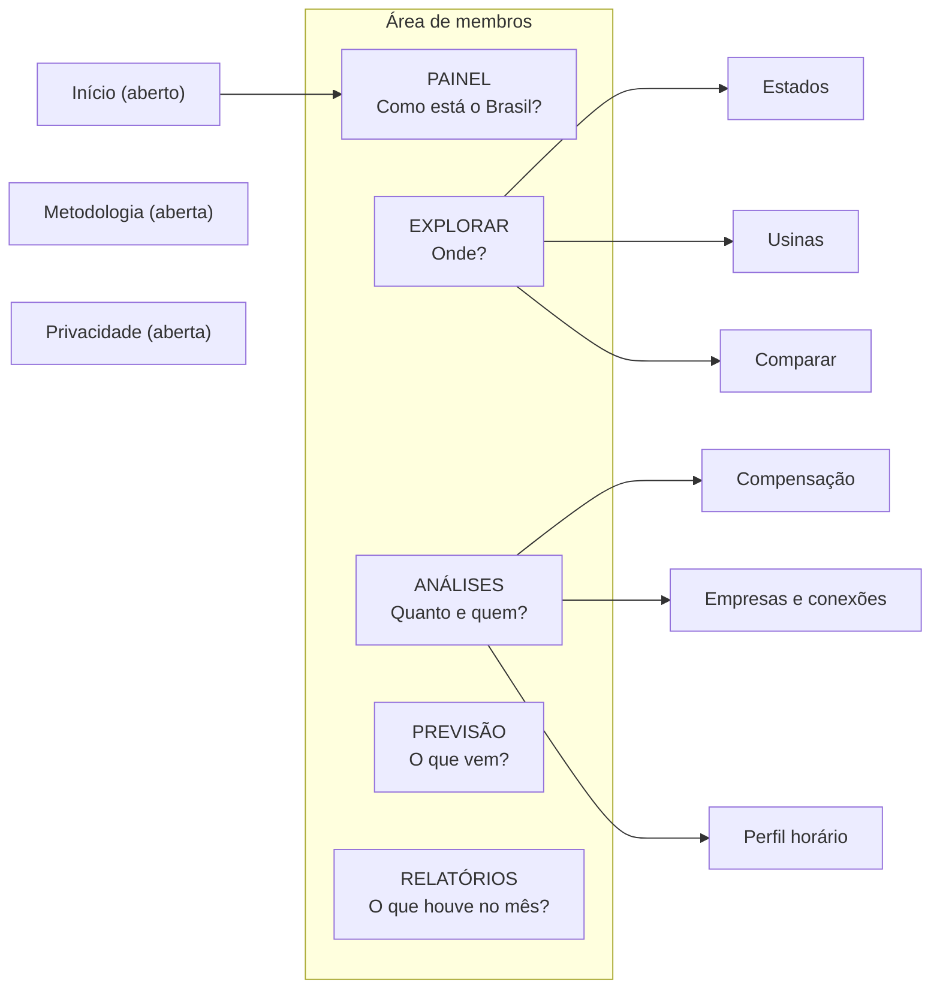
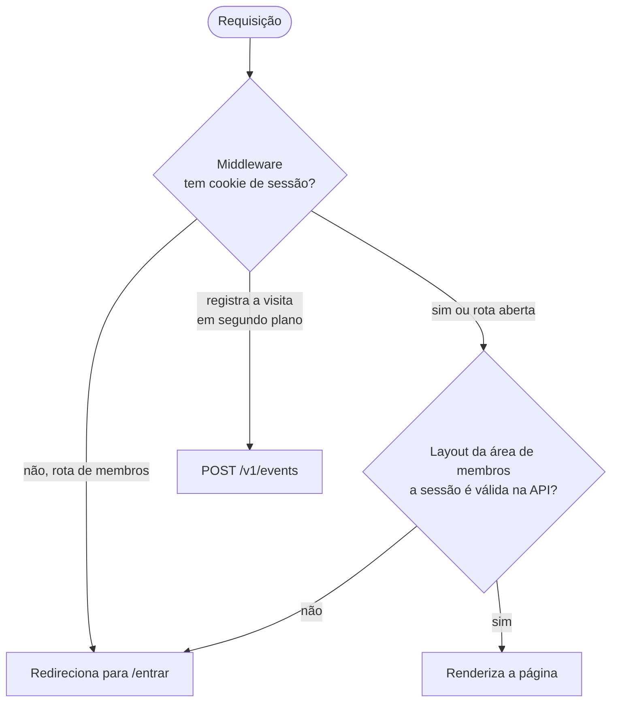

# 4. spillway-web: o site

## 4.1 Papel e tecnologia

É a cara do produto: **Next.js 15** (App Router, React), **Tailwind v4** para o visual, **Recharts** para os gráficos, tema claro e escuro. Fala **somente com a `spillway-api`**; nunca com o banco. Hospedado na **Vercel** (fora da AWS).

## 4.2 O mapa do site (menu por pergunta)

O menu foi organizado pela pergunta que a pessoa traz, não pelo tipo de página:

| Seção | Pergunta | Conteúdo |
|---|---|---|
| Painel | "Como está o Brasil?" | Indicadores, séries por fonte e subsistema, filtro de período, link para o relatório do mês |
| Explorar | "Onde?" | Abas Estados, Usinas e Comparar (Comparar também é um botão nas páginas de estado e usina) |
| Análises | "Quanto, quem e quando?" | Compensação, empresas e pontos de conexão, perfil horário, com **Baixar** (PDF ou dados) |
| Previsão | "O que vem?" | Mapa de calor do risco por hora e os resultados do treino do modelo |
| Relatórios | "O que houve no mês?" | Um relatório por mês, de 2021 em diante, com gráficos e PDF |
| Metodologia | "Como se calcula?" | Aberta a todos (rodapé) |

> **Por quê?** A navegação antiga misturava geografia (Estados), entidade (Usinas), narrativa (Relatórios), lente analítica (Análises) e ação (Comparar). Agrupar por pergunta reduziu o menu de sete para cinco itens e tirou a redundância (o relatório mensal repetia o Painel em texto; agora o Painel aponta para ele).

## 4.3 Quem pode ver o quê

A verificação em duas etapas existe porque o cookie sozinho pode ser forjado. O **middleware** é rápido e barra a maioria. O **layout** confirma a sessão de verdade perguntando à API (`/v1/auth/me`).

## 4.4 Como as páginas carregam (e por que ficam rápidas)

Medições do agente de performance mostraram que **quase toda a lentidão local era o modo de desenvolvimento** (`next dev` compila cada página na primeira visita). Em produção, uma página responde em 35 a 90 ms. Mesmo assim, três técnicas ajudam:

| Técnica | Efeito |
|---|---|
| `loading.tsx` na área de membros | Mostra um esqueleto na hora; o navegador consegue pré-buscar |
| Cache do roteador (30 s dinâmicas, 180 s estáticas) | Voltar a uma página visitada é instantâneo |
| Cache de `fetch` com tags | Os dados da API ficam por 1 hora e são invalidados pelo pipeline |

> **Atenção:** no ambiente local, o cache de `fetch` do Next fica em `.next/cache/fetch-cache` e **persiste entre reinícios**. Depois de um backfill ou de apagar um relatório, apague essa pasta, senão o site mostra dados antigos. Em produção, o pipeline invalida as tags sozinho.

## 4.5 Rotas internas (`/api/*`)

| Rota | Função |
|---|---|
| `/api/revalidate` | Recebe o aviso da API e invalida tags do cache |
| `/api/baixar/analise`, `/api/baixar/relatorio/[slug]` | Proxy de download: confere a sessão, pede o arquivo à API e entrega com o nome certo |
| `/api/session` | Dá ao cabeçalho o estado de login |
| `/api/track` | Registra eventos de uso |
| `/api/search`, `/api/auth/*` | Busca de usinas e autenticação do administrador |

> **Por quê o proxy de download?** O navegador baixa do próprio site (mesma origem), a sessão é conferida no servidor e o limite de requisições da API enxerga o IP real do visitante.

## 4.6 Pontos de usabilidade que valem registrar

- **Newsletter na home:** quem está logado vê um botão para ativar o e-mail mensal (um clique, sem confirmação, porque o endereço já foi verificado). Depois de ativar, a home só diz "Você habilitou a newsletter mensal". O cancelamento fica na página "Cancelar newsletter" do rodapé.
- **Previsão:** abre com uma barra de progresso de 10 segundos, uma vez por sessão do navegador, com botão "Mostrar agora" e respeito à preferência de menos animação.
- **Tema:** o tema escuro vale mesmo antes do script de tema rodar, evitando o "flash" cinza ao recarregar.
- **Conta já existente:** o cadastro avisa claramente "já existe uma conta", com links para entrar e recuperar a senha.

## 4.7 Variáveis de ambiente principais

| Variável | Para quê |
|---|---|
| `API_URL` | Onde está a API (local: `http://127.0.0.1:8000`) |
| `WEB_API_SECRET` | Segredo compartilhado para repassar o IP real do visitante |
| `REVALIDATE_SECRET` | Segredo da rota `/api/revalidate` |
| `NEXT_PUBLIC_SITE_URL` | URL pública (canônica, Open Graph) |

## 4.8 Testes e qualidade

Vitest e Testing Library (cerca de 160 testes), ESLint, Prettier e TypeScript estrito. O CI também roda auditoria de dependências e varredura de segredos.
