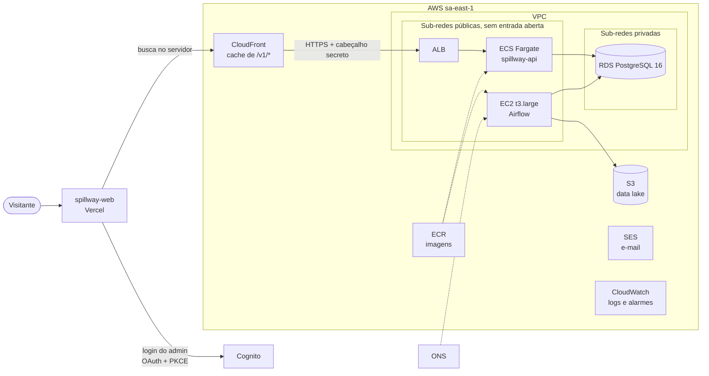

# 5. spillway-infra: a infraestrutura na AWS

## 5.1 Papel

Define **toda a infraestrutura do Spillway em código** (Terraform), na região **sa-east-1 (São Paulo)**. Nada é criado clicando no console: o que está no repositório é o que existe. O site em si roda na **Vercel**, fora da AWS.

## 5.2 A arquitetura

## 5.3 Módulos Terraform

| Módulo | O que cria |
|---|---|
| `network` | VPC, 2 sub-redes públicas e 2 privadas em 2 zonas, gateway da internet, endpoint do S3 |
| `lake` | Bucket do data lake: versionado, criptografado, sem acesso público; `bronze/` migra para armazenamento barato após 30 dias |
| `ecr` | Repositórios de imagens (API e pipeline), com varredura ao enviar |
| `database` | RDS PostgreSQL 16 criptografado, privado, backups de 7 dias, senha mestre gerenciada pelo RDS, usuários separados para a API e para o pipeline |
| `api` | ALB, cluster ECS, serviço Fargate (0,25 vCPU, 0,5 GB), tarefa de migração |
| `cdn` | CloudFront, políticas de cache |
| `auth` | Cognito: pool de usuários (MFA obrigatório), grupo `admin`, clientes para o site e para o pipeline |
| `airflow` | EC2 sem SSH e sem porta de entrada (acesso por SSM), com Docker |
| `email` | Identidade de domínio no SES (quando há domínio) |
| `observability` | Grupos de log, tópico SNS por e-mail, alarmes (5xx do ALB, tarefas, banco, falhas do Airflow) |
| `github_oidc` | Papéis para o GitHub Actions entrar na AWS **sem chaves fixas** |

## 5.4 Os usuários do banco e as permissões

O banco tem dois usuários de aplicação com permissões **mínimas e separadas**:

| Usuário | Pode |
|---|---|
| `energia_api` | Ler tudo; escrever somente nas tabelas da API (relatórios, membros, sessões, newsletter, envios mensais, eventos) |
| `energia_data` | Escrever somente nas tabelas que o pipeline carrega; **não consegue nem ler** dados de membros |
| `energia_forecast` (previsto) | Ler tudo; inserir e apagar nas três tabelas de previsão; atualizar apenas duas colunas de controle |

Um **teste no CI** garante isso: ele sobe um Postgres, aplica as migrações da API e confere que cada usuário escreve só onde deve. Toda tabela nova precisa ser classificada, senão o CI falha. Foi assim que descobrimos que a tabela `email_dispatch` precisava de permissão para a API.

> **Por quê?** Se o pipeline for comprometido, ele não alcança os dados das pessoas cadastradas. Se a API tiver um bug, ela não consegue apagar os dados do ONS.

## 5.5 Decisões de infraestrutura

> **Por quê sem NAT gateway?** Um NAT gateway custa em torno de US$ 40 por mês parado. Em vez dele, as tarefas ficam em sub-redes públicas **sem nenhuma porta de entrada aberta** (só aceitam tráfego vindo do ALB), o banco fica em sub-redes privadas e o S3 é acessado por um endpoint. A conta total fica na faixa de **US$ 170 a 270 por mês**, e a maior parte é a máquina do Airflow.

> **Por quê deploy sem chaves (OIDC)?** Chaves de AWS guardadas no GitHub são um risco: vazam, não expiram. Com OIDC o GitHub Actions prova quem é e recebe uma credencial temporária. Cada repositório tem seu papel, e a aplicação do Terraform só pode ser assumida pelo ambiente `production`, que exige aprovação de uma pessoa.

> **Atenção:** os nomes **implantados** continuam com o prefixo antigo `energia` (repositórios ECR, o escopo `energia-api/admin` do Cognito, os usuários `energia_api` e `energia_data`, o caminho `/opt/energia-data` na EC2). Renomear esses recursos exige migração de infraestrutura e foi deixado de fora de propósito. Além disso, depois da renomeação dos repositórios no GitHub, a confiança do OIDC aponta para os nomes novos, mas **só vale depois de um `terraform apply`** em produção.

## 5.6 O que falta para entrar no ar

O repositório tem um **roteiro de primeira implantação** (state bucket, variáveis, plan e apply, migração da API, usuários do banco, primeiro administrador no Cognito, Airflow na EC2, GitHub, Vercel e SES). Nada disso foi aplicado em produção ainda: **o Spillway roda hoje só no seu computador**.

## 5.7 Custo mensal estimado

| Componente | Ordem de grandeza (US$/mês) |
|---|---|
| EC2 do Airflow + disco | 90 a 120 |
| RDS | 20 a 35 |
| ALB | 20 a 30 |
| Fargate (1 tarefa) | 10 a 15 |
| IPv4 público | 15 a 25 |
| CloudWatch, Secrets, S3, CloudFront, outros | 15 a 40 |
| **Total** | **170 a 270** |

> **Atenção:** é uma estimativa grosseira, não um orçamento. Confira na calculadora da AWS antes de decidir. Reduzir a máquina do Airflow depois de medir o uso é a economia mais óbvia.
