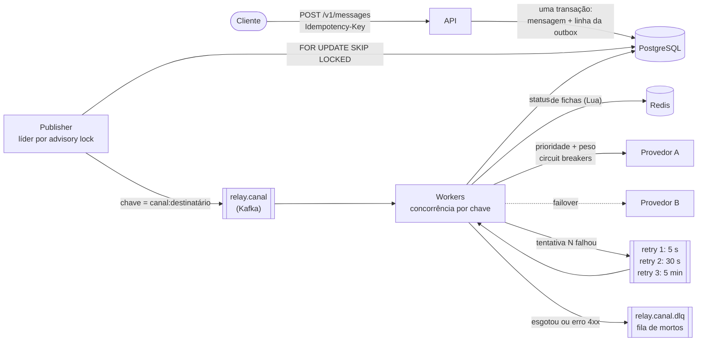
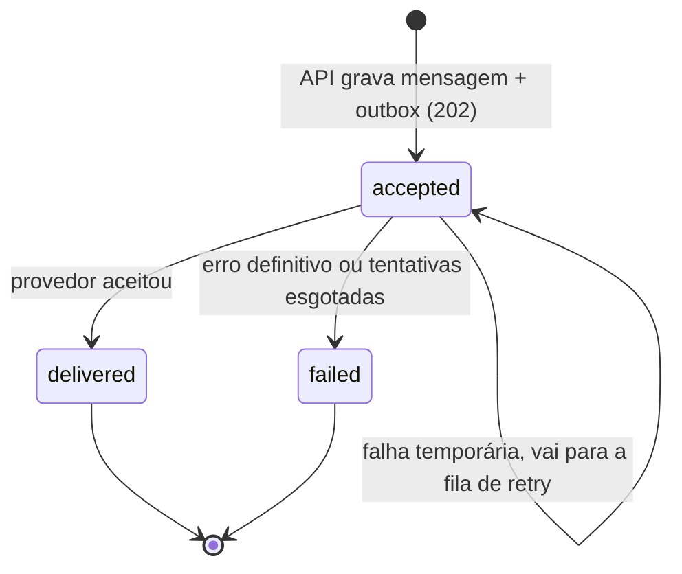
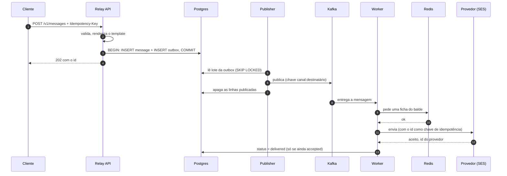
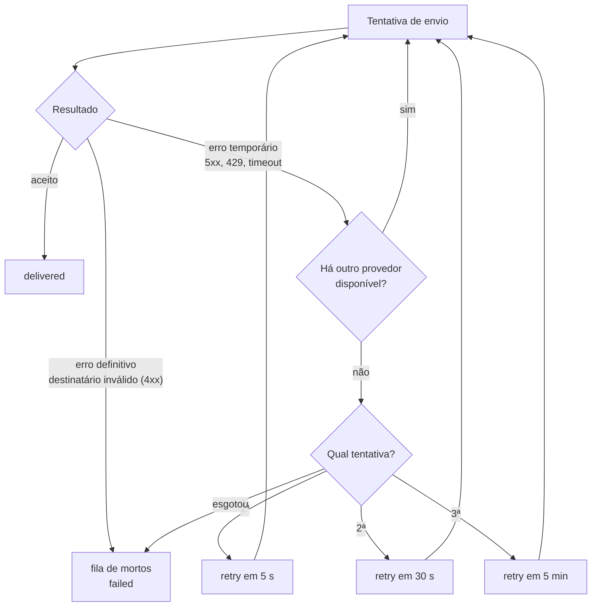

# 6. Relay: a plataforma de mensagens

## 6.1 O problema que ele resolve

Enviar **uma** mensagem é fácil. Enviar milhões por dia exige responder a perguntas difíceis:

| Pergunta | Resposta do Relay |
|---|---|
| O que acontece com uma mensagem aceita quando o Kafka está fora do ar? | Ela espera numa tabela do Postgres (a *outbox*) e **nunca se perde**. |
| E se o provedor de SMS cair no pico? | O tráfego **troca de provedor na mesma tentativa**. |
| E se o cliente repetir uma requisição que deu timeout? | A **chave de idempotência** devolve a mensagem original, sem enviar duas vezes. |
| Como 12 servidores respeitam um contrato de 1.500 msg/s? | **Um balde de fichas único no Redis**, compartilhado por todos. |
| Como dois códigos (OTP) para a mesma pessoa saem na ordem certa? | A chave do Kafka é **o destinatário**, então ficam na mesma partição. |

Cada resposta é uma decisão com custos e benefícios, registrada em **ADRs** (oito no total).

## 6.2 A arquitetura

Uma única imagem de software, quatro papéis escolhidos pela variável `APP_ROLE`:

| Papel | O que faz | Como escala |
|---|---|---|
| `api` | Valida, grava mensagem e linha da outbox **numa transação** e responde `202` | Horizontal (sem estado) |
| `publisher` | Esvazia a outbox para o Kafka em lotes | 2 réplicas, 1 ativa (trava de líder) |
| `worker` | Consome, limita a taxa, escolhe o provedor, tenta de novo, manda para a fila de mortos | Horizontal, até o número de partições |
| `migrate` | Aplica as migrações do banco com uma trava | Tarefa pontual |



## 6.3 A vida de uma mensagem



`accepted`, `delivered` e `failed` dizem **o que o Relay fez**. O que o destinatário recebeu de fato é outra dimensão, o `delivery_status` (capítulo 7).

## 6.4 Sequência de um envio feliz



> **Por quê a outbox?** Se a API escrevesse no banco **e** no Kafka separadamente, uma queda entre os dois perderia ou duplicaria mensagens. Escrevendo só no Postgres (uma transação) e deixando um processo separado levar para o Kafka, a disponibilidade da API depende apenas do banco. A mensagem aceita é uma promessa cumprida.

## 6.5 Falhas e novas tentativas



- **Filas de retry em camadas:** três tópicos, cada um com **um atraso fixo**. Como todas as mensagens de uma camada esperam o mesmo tempo, elas vencem na ordem de chegada. O consumidor olha a primeira, e se ainda não venceu, **pausa a partição** até vencer. Sem temporizador por mensagem.
- **Mensagem malformada** (que nem dá para ler) vai direto para a fila de mortos e nunca trava uma partição.
- **Fila de mortos** guarda o erro para análise e a mensagem fica `failed`.

> **Por quê?** Um cronômetro por mensagem (ou um `sleep` no consumidor) não escala. Camadas com atraso fixo transformam "espere 30 s" em "pause a partição até o primeiro item vencer".

## 6.6 Troca de provedor e circuit breaker

Cada canal tem uma lista de provedores com **prioridade** e, dentro da mesma prioridade, **peso** (por exemplo, 75% e 25% entre dois gateways de SMS). Cada tentativa percorre a lista: se o primeiro falha de forma recuperável, o próximo é usado **na mesma tentativa**.

Cada provedor tem um **circuit breaker** (disjuntor):

| Parâmetro | Valor |
|---|---|
| Janela | 50 chamadas |
| Mínimo para decidir | 20 chamadas |
| Abre com | 50% de falhas |
| Meio aberto depois de | 15 s, com 3 chamadas de prova |

Erros do cliente (destinatário inválido) e a limitação local **não** contam contra a saúde do provedor.

> **Por quê?** Sem disjuntor, um provedor morto custa um timeout por mensagem. Com ele, custa uma verificação rápida. Os disjuntores vivem **em cada processo**, sem estado compartilhado: simples e sem ponto único de falha, ao preço de cada servidor descobrir a falha por conta própria.

## 6.7 Limite de taxa para toda a frota

Os provedores têm contratos por conta (por exemplo, 1.500 SMS por segundo), não por servidor. Com servidores que sobem e descem, um limite por processo estaria errado por um fator igual ao número de réplicas.

- Um **balde de fichas por provedor no Redis**, compartilhado.
- O "pega uma ficha" é um **script Lua**, executado de forma atômica pelo Redis: dois workers nunca gastam a mesma ficha.
- O worker espera até **250 ms** por uma ficha. Passando disso, a tentativa falha de forma recuperável e o roteador **transborda para o próximo provedor**. Um primário saturado manda o excesso para o secundário, em vez de fazer fila.
- Se o Redis cair, os workers **param de entregar**, em vez de violar o contrato: é a escolha conservadora para um recurso pago e limitado.

## 6.8 Idempotência em cada salto

O sistema é **pelo-menos-uma-vez**, e cada salto remove as duplicatas que consegue:

| Salto | Origem da duplicata | Proteção |
|---|---|---|
| Cliente para API | Cliente repete | Cabeçalho `Idempotency-Key`, único no Postgres. Mesma chave e mesmo conteúdo: devolve o original (`200`). Mesma chave e conteúdo diferente: `409`. |
| Outbox para Kafka | Lote republicado | Produtor idempotente |
| Kafka para worker | Reentrega após queda | O worker ignora o que já está `delivered` ou `failed`, e só atualiza `WHERE status = 'accepted'` |
| Worker para provedor | Queda depois de o provedor aceitar | O id da mensagem vai como chave de idempotência |

> **Atenção:** a única janela restante é inerente a provedores externos: um worker que morre depois de um provedor **sem suporte a chave de idempotência** (SES e Twilio não têm) aceitar a mensagem. O risco é um duplicado raro, documentado.

## 6.9 Ordem por destinatário

As mensagens são chaveadas por `canal:destinatário`, então uma pessoa cai sempre na mesma partição. Dentro de um lote, um **executor por chave** processa destinatários diferentes em paralelo (até 64) e o mesmo destinatário em sequência. Os deslocamentos (offsets) só são confirmados depois do lote inteiro, então uma queda **reprocessa** em vez de pular.

Uma mensagem que passou por retry pode ser ultrapassada por uma mais nova para a mesma pessoa, que é exatamente o que se quer para códigos de uso único (OTP).

## 6.9.1 Templates e campos dinâmicos

O Relay **não guarda modelos**. Cada produto manda o seu HTML e os valores (ADR 8):

```json
{
  "channel": "email",
  "to": "ana@example.com",
  "subject": "Seu código: {{code}}",
  "body": "Olá {{name}}, seu código é {{code}}.",
  "html": "<h1>Olá {{name}}</h1><p>Código <b>{{code}}</b></p>",
  "variables": { "name": "Ana", "code": "482913" },
  "metadata": { "product": "energia", "template": "verification-code" }
}
```

- `{{nome}}` é substituído em **uma passada** (um valor que contém `{{outro}}` não é expandido de novo).
- Dentro do HTML, os valores são **escapados**: um nome como `<script>` nunca vira código na caixa de entrada.
- Placeholder sem variável é erro `400`, não um e-mail com `{{code}}` escrito.
- O `html` só vale para e-mail. O texto continua obrigatório (é a alternativa em texto).

> **Por quê?** Cada produto tem seus e-mails e seu visual. O Relay não deve conhecer nenhum deles, nem virar um catálogo que cada produto precise "implantar" antes de enviar. Mudar um e-mail não exige deploy do Relay.

## 6.10 Provedores reais

| Provedor | Canal | Observações |
|---|---|---|
| **Amazon SES** | E-mail | Usa a cadeia padrão de credenciais da AWS. As tentativas do SDK são desligadas (o Relay faz as suas). O id da mensagem vai numa *tag* do SES para ligar bounces e reclamações de volta. |
| **Twilio** | SMS e WhatsApp | Erros mapeados em definitivos (número inválido, descadastrado) e recuperáveis (limite, 5xx) |
| **Genérico HTTP** | Qualquer | `POST {url}/v1/send`. Usado pelos provedores simulados do ambiente local, e fácil de colocar na frente de um gateway interno |

> **Atenção:** a conta do SES está no **modo sandbox**: só envia para endereços verificados (hoje, o seu). Para enviar a outras pessoas é preciso pedir a saída do sandbox na AWS.

## 6.11 A API do Relay

| Método | Rota | Para quê |
|---|---|---|
| `POST` | `/v1/messages` | Enviar. `202` com `{id, status}`. `200` com `Idempotent-Replayed: true` para repetição igual. `409` para mesma chave com conteúdo diferente. `400` lista todos os erros de validação. `422` se o destinatário está na lista de supressão. |
| `GET` | `/v1/messages/:id` | Status, tentativas, provedor usado, último erro, status de entrega e recibos |
| `POST` | `/v1/receipts` | Recibo de entrega neutro (capítulo 7) |
| `DELETE` | `/v1/suppressions/:canal/:destinatário` | Tira alguém da lista de supressão |
| `GET` | `/health/live`, `/health/ready` | Saúde (processo e dependências) |
| `GET` | `/metrics` | Prometheus |

Com a variável `API_KEYS` definida, toda chamada exige `X-Api-Key`.

## 6.12 Observabilidade

Prometheus coleta as métricas de cada papel e o Grafana (porta 3030) tem painéis prontos: mensagens aceitas, entregues, tentativas, estado dos disjuntores, idade da outbox, recibos recebidos. O script de carga lê as próprias métricas do serviço, então o relatório mede **a entrega ao provedor**, não só "a API disse aceito".

## 6.13 Números medidos

Teste de carga com k6, tudo rodando no mesmo notebook (Intel i7-7700HQ, 4 núcleos, 16 GB), com provedores simulados, **1 API, 1 publisher e 2 workers**:

| Métrica | 250 msg/s por 2 min | 500 msg/s por 2 min |
|---|---|---|
| Aceitas (202) | 29.920 de 30.000 | 35.585 de 60.000 |
| `POST /v1/messages` p50 / p95 | 18 ms / 210 ms | 1,48 s / 2,65 s |
| Entregues ao provedor | 29.920 (100% das aceitas) | todas, depois do teste |
| Entrega ponta a ponta p50 / p95 / p99 | 258 ms / 709 ms / 1,43 s | não medido |
| Idade máxima da outbox | 394 ms | não medido |

> **Honestidade:** uma API sozinha satura perto de **290 mensagens aceitas por segundo** neste notebook (cada requisição é uma transação no Postgres). A API não tem estado, então escala horizontalmente. Numa corrida anterior, a entrega ficou parada porque meu `.env` local só consumia o canal de e-mail; ao liberar todos os canais, **dois workers esvaziaram 49 mil mensagens em cerca de 90 s (≈ 540 msg/s)**. Os limiares do k6 foram ultrapassados nas duas corridas, e os números foram publicados como saíram.

## 6.14 Como subir localmente

```
cd relay
docker compose up -d --build api publisher worker postgres redis redpanda
curl localhost:3000/health/ready
```

| Serviço | Porta |
|---|---|
| API | 3000 |
| Publisher (métricas) | 3001 |
| Redpanda (Kafka) | 19092 |
| Postgres | 5432 |
| Prometheus / Grafana | 9090 / 3030 |
| Provedores simulados (SMS, e-mail, WhatsApp, push) | 8091 a 8096 |

> **Dica:** `PROVIDERS=providers.real.json` troca os simulados pelo SES real; `WORKER_CHANNELS` controla quais canais os workers consomem. Para testes de carga, use sempre os simulados.

Há também manifestos **Kubernetes** (`k8s/`) com sondas, requisições de recursos, contêineres sem root, PodDisruptionBudgets e HPAs.
