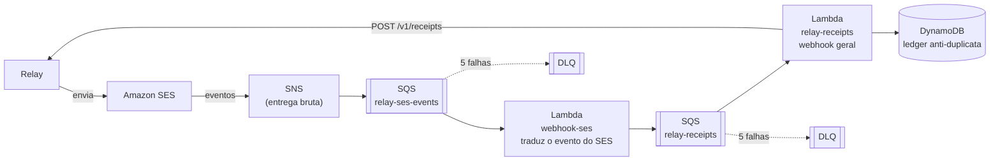
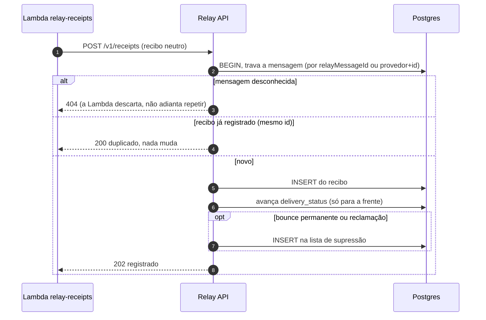

# 7. Os satélites do Relay: gateway, recibos e Terraform

## 7.1 relay-api-gateway: a porta de entrada simples

É um servidor Node **sem dependências** que fica na frente do Relay. Quem quer enviar mensagens (como a `spillway-api`) fala com ele, e ele repassa para a API do Relay.

| Responsabilidade | Detalhe |
|---|---|
| Autenticação | `X-Api-Key` dele (`GATEWAY_API_KEYS`); usa outra chave para falar com o Relay |
| Validação rápida | Formato da requisição e canais habilitados (`ALLOWED_CHANNELS`); o resto da validação continua sendo do Relay, que é a fonte da verdade |
| Passagem | Repassa `Idempotency-Key`, `html`, `variables` e `metadata`; devolve os erros do Relay sem alterar |
| Limite de corpo | 512 KB (cabe um HTML de e-mail grande) |

> **Por quê um gateway, e não chamar o Relay direto?** O gateway **não pula o Relay**: ele repassa para a mesma API, então a outbox e a idempotência continuam valendo. A vantagem é separar "quem pode enviar" (chaves por produto) de "como se envia" (o Relay), e poder expor só o gateway.

## 7.2 relay-receipts: o que o provedor diz depois

Aceitar uma mensagem não é entregá-la. O SES pode devolver o e-mail minutos depois (*bounce*), ou a pessoa pode marcar como spam (*complaint*). Isso precisa voltar para o Relay para duas coisas:

1. **Atualizar o status de entrega** da mensagem;
2. **Parar de enviar** para endereços que devolvem ou reclamam, porque isso destrói a reputação do remetente.

### O caminho do recibo



Duas funções Lambda em **Python**, com papéis bem separados:

| Função | Conhece | Faz |
|---|---|---|
| `webhook-ses` | O formato do **SES** | Lê o evento bruto, valida e transforma num **recibo neutro** (ver abaixo), e coloca na segunda fila |
| `relay-receipts` | **Nenhum provedor** | É o "webhook geral": pega qualquer recibo neutro, confere num ledger (DynamoDB) se já viu, e envia para o Relay |

Para um novo provedor (Twilio, por exemplo), basta escrever um tradutor pequeno que publica na **mesma fila**. O `relay-receipts` e o Relay não mudam.

### O recibo neutro

Um formato único, independente do provedor:

```json
{
  "schema": 1,
  "id": "ses:7f3c...",
  "provider": "ses",
  "providerMessageId": "01030...",
  "relayMessageId": "01a182e5-...",
  "channel": "email",
  "recipient": "ana@example.org",
  "type": "bounced",
  "permanent": true,
  "reason": "smtp; 550 5.1.1 user unknown",
  "occurredAt": "2026-10-28T14:04:01Z"
}
```

Tipos: `sent`, `delivered`, `delayed`, `bounced`, `complained`, `rejected`. O `id` é derivado do evento do provedor, então o mesmo evento sempre gera o mesmo id.

## 7.3 O que o Relay faz com o recibo

`POST /v1/receipts` (ADR 7):



### Status que só anda para a frente

Os eventos chegam **fora de ordem**. Por isso o `delivery_status` tem uma hierarquia e nunca regride:

`sent` < `delayed` < `delivered` < `bounced` ou `rejected` < `complained`

Um `sent` atrasado não desfaz um `delivered`.

### Lista de supressão

Um *bounce* permanente ou uma reclamação põe o destinatário na tabela `suppressions`. Depois disso, `POST /v1/messages` para ele responde **422** antes de gravar qualquer coisa. Um bounce temporário **não** suprime. `DELETE /v1/suppressions/:canal/:destinatário` libera de novo. E-mails são comparados em minúsculas; telefones não são alterados.

> **Atenção:** só o envio **novo** é barrado. Mensagens que já estavam na fila antes do bounce ainda saem.

## 7.4 Por que SQS entre as duas Lambdas, e não API Gateway

| Critério | **SQS (escolhido)** | API Gateway |
|---|---|---|
| Relay fora do ar | A fila **guarda** (14 dias) | O recibo falha ou se perde |
| Tentativas e fila de mortos | Prontas | A construir |
| Pico de eventos | O limite de concorrência protege o Relay | O Relay recebe tudo de uma vez |
| Exposição pública | Nenhuma | Um endpoint a autenticar e proteger |
| Custo | Menor nessa escala | Maior |

O API Gateway continua sendo a ferramenta certa para provedores que **empurram** para nós (como o Twilio). O tradutor dele validaria a assinatura e publicaria na mesma fila.

## 7.5 Logs estruturados

As Lambdas escrevem **uma linha JSON por fato** no CloudWatch (retenção de 14 dias). Cada linha tem nível, mensagem, qual função e o id da invocação. Cada recibo ganha a sua linha com `receipt_id`, provedor, ids, canal, tipo, motivo e **destinatário mascarado** (`a***@example.org`), para os logs não virarem uma lista de endereços.

| Mensagem | Quando |
|---|---|
| `receipt queued` / `receipt not queued` | O tradutor enfileirou (ou falhou ao enfileirar) |
| `ses event ignored` | Tipo de evento que o Relay não acompanha |
| `receipt delivered to relay` | O Relay respondeu `recorded` ou `duplicate` |
| `receipt not usable by relay` | `unmatched` ou `rejected` |
| `relay unavailable, will retry` | O Relay falhou |
| `receipt already handled` | O ledger já tinha visto |

Para seguir uma mensagem pelas duas funções, use o CloudWatch Logs Insights filtrando por `relay_message_id`.

## 7.6 relay-terraform: tudo da AWS do Relay em código

| Arquivo | Cria |
|---|---|
| `main.tf` | Identidade do SES, *configuration set*, destino de eventos, tópico SNS, fila `relay-ses-events` e a DLQ |
| `dns.tf` | Registros DKIM, SPF e DMARC (quando há zona no Route 53) |
| `iam.tf` | Política de envio, usuário e chave opcionais, papel opcional para EKS |
| `receipts.tf` | Fila `relay-receipts` e DLQ, tabela DynamoDB, as duas Lambdas, papéis, gatilhos, alarmes |

Já aplicado na conta **<id-da-conta>**, região **sa-east-1**: 2 Lambdas, 4 filas, 1 tabela e 2 alarmes. O código das funções vem do repositório `relay-receipts`, empacotado pelo Terraform.

> **Atenção (estado atual):** a Lambda `relay-receipts` está **desligada de propósito** (o gatilho SQS está desabilitado) porque o Relay roda só no seu computador, e a AWS não o alcança. Os recibos ficam guardados na fila (14 dias). Para ligar, o Relay precisa de uma URL pública protegida por chave de API e depois `terraform apply -var relay_url=...`. A DLQ de eventos do SES tem 16 mensagens antigas (restos de testes) e por isso um alarme em estado ALARM.
