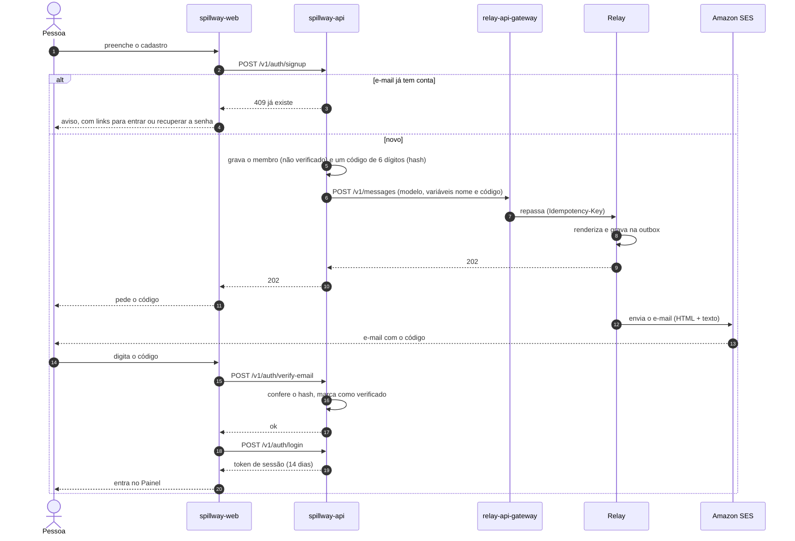
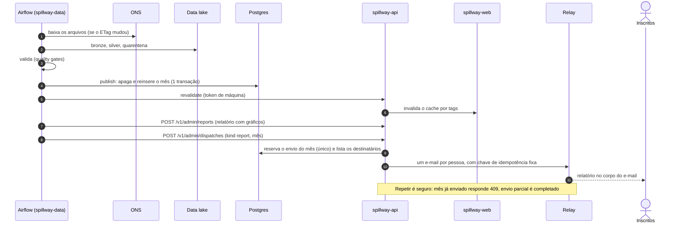
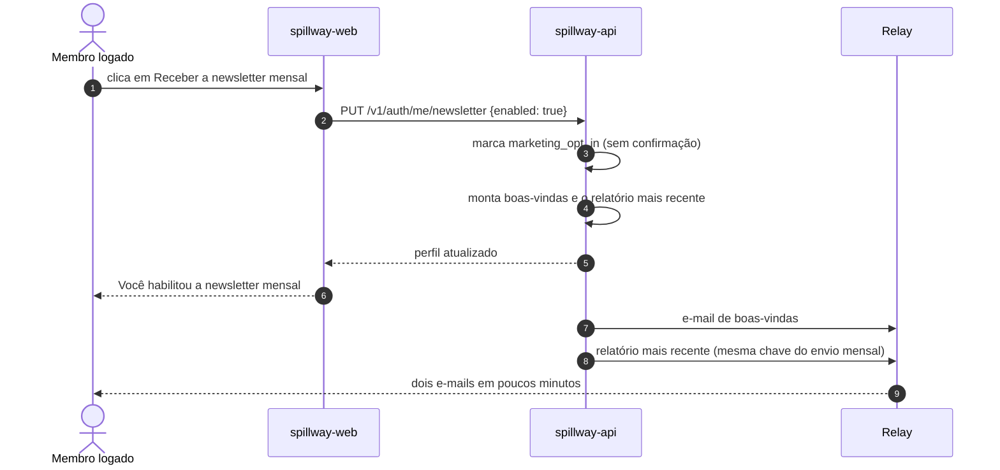
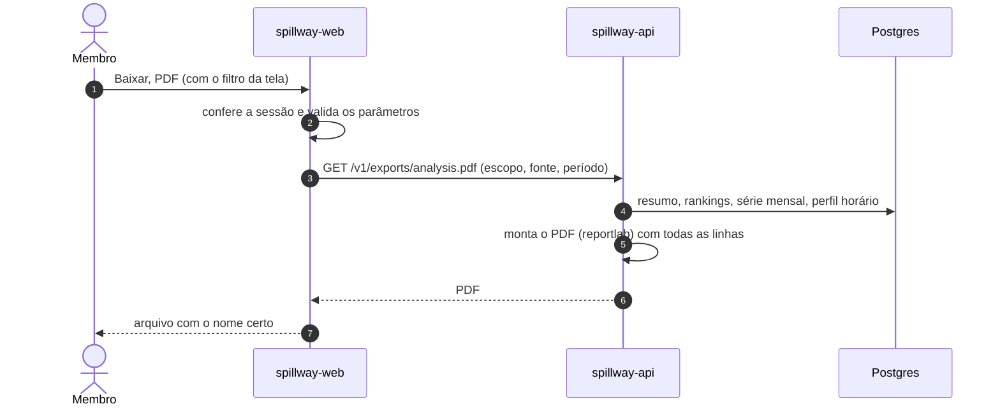
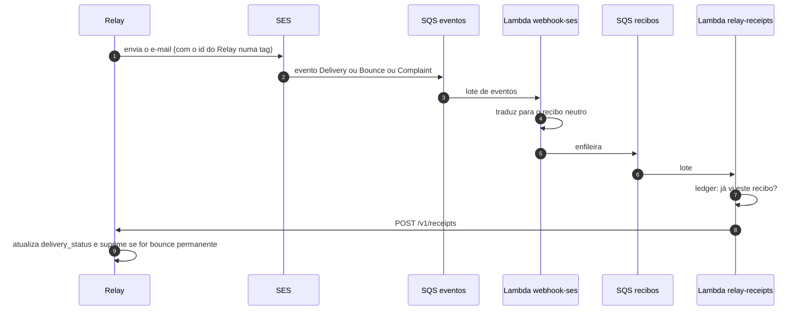
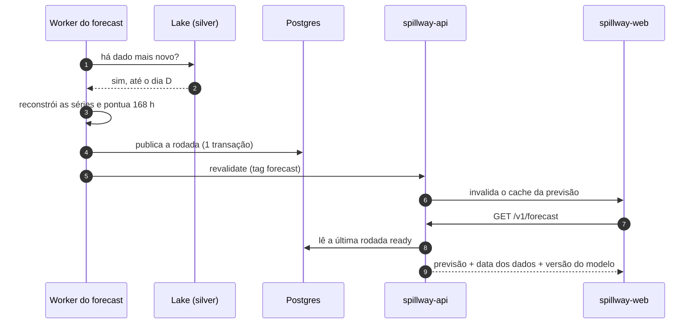

# 9. Fluxos de ponta a ponta

Este capítulo junta as peças. Cada fluxo mostra **quem fala com quem, em que ordem**, atravessando os projetos.

## 9.1 Cadastro de um membro (com código por e-mail)

> **Por quê código e não link?** O código se digita na própria tela, funciona no celular sem abrir outro navegador e tem limite de tentativas. É mais difícil de interceptar em encaminhamentos e prévias de e-mail.

## 9.2 Um novo mês do ONS: do arquivo ao e-mail

É o ciclo mais importante do produto. Acontece sozinho no dia 3 de cada mês.

> **Por quê um envio por mês, com chave por pessoa?** Se o pipeline rodar de novo (ou o envio parar no meio), ninguém recebe duas vezes. O Relay responde "já enviei" para a mesma chave.

## 9.3 Ativar a newsletter na home

O relatório de boas-vindas é construído **exatamente** como o envio mensal o constrói, com a mesma chave de idempotência. Assim, quem ativa antes do envio do mês não recebe o relatório duas vezes.

## 9.4 Baixar a análise em PDF

## 9.5 O recibo de entrega de um e-mail

## 9.6 Da previsão ao site

> **Atenção:** o worker precisa estar rodando (capítulo 8.10) e a API precisa de `REVALIDATE_SECRET` para o site atualizar na hora.

## 9.7 Esqueci a senha

Segue o mesmo desenho do cadastro: a API gera um código (modelo "redefinir senha"), o Relay entrega, a pessoa digita o código com a nova senha, e a API troca a senha e **encerra as sessões antigas**.

## 9.8 Resumo: onde cada decisão aparece

| Fluxo | Decisões em ação |
|---|---|
| Cadastro | Código por e-mail; Relay com outbox e idempotência; modelos de e-mail do próprio produto |
| Novo mês | Carga idempotente com reprocessamento; invalidação de cache por evento; envio único por mês |
| Newsletter | Mesma chave do envio mensal; sem confirmação para quem já verificou o e-mail |
| Recibos | Fila entre as Lambdas; recibo neutro; status que só avança |
| Previsão | Publicação pelo banco; API dona do esquema |
